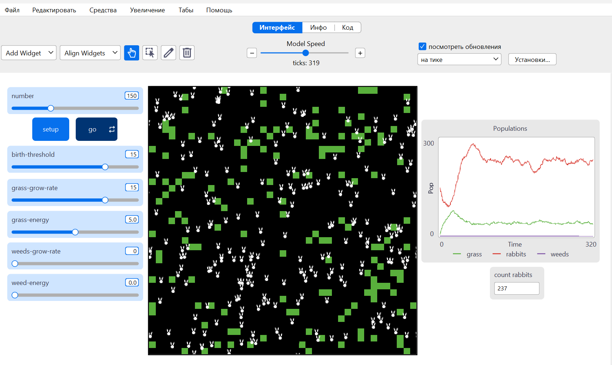
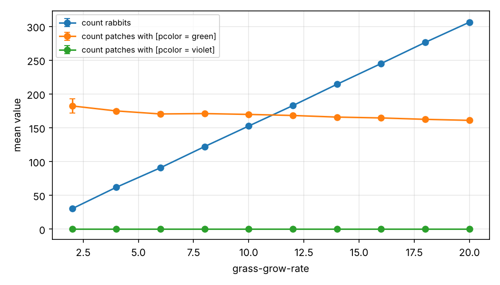
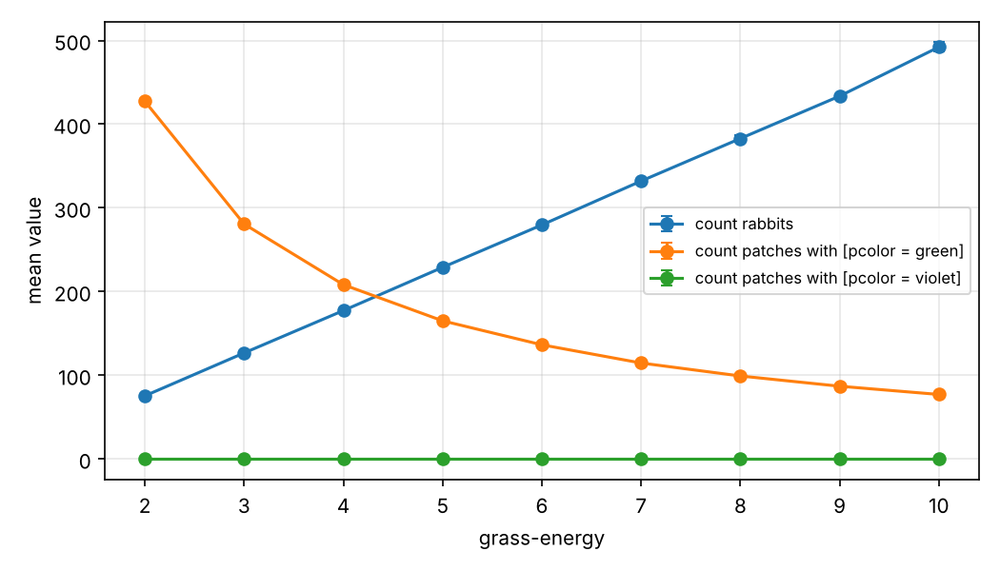
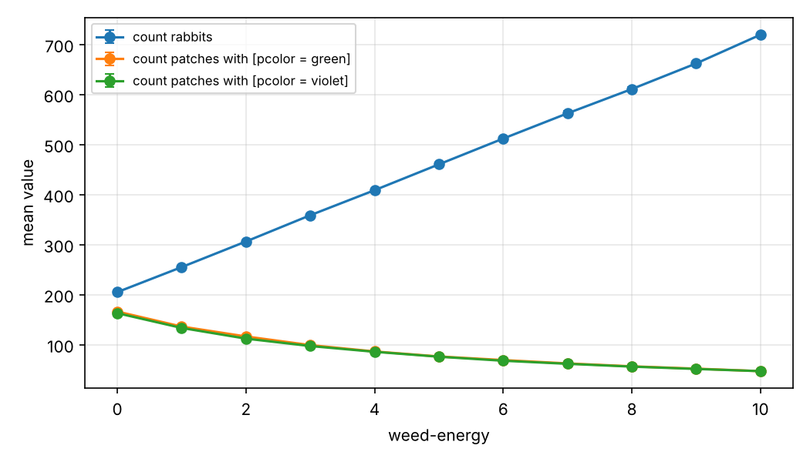

# Лабораторна робота 1

Тема: опис моделі та обчислювальні експерименти в NetLogo

Студент: Лімаренко Дмитро Ігорович, група СПм-25-2, варіант 6

## 1. Модель

Назва: Rabbits Grass Weeds (бібліотека NetLogo, Models Library -> Biology).

Модель описує популяцію кроликів, що живуть на полі з травою і бур'яном. Кролики випадково блукають полем і витрачають на це енергію. Коли кролик потрапляє на клітинку з травою (або з бур'яном), він з'їдає її і отримує енергію. Якщо енергії стає достатньо, кролик народжує нового, а якщо вона закінчується - гине. Трава й бур'ян самі виростають на порожніх клітинках з певною ймовірністю. Так модель показує, як чисельність тварин залежить від кількості та "калорійності" їжі. За замовчуванням бур'яну в моделі немає, його вмикають окремим параметром.

## 2. Агенти і середовище

Середовище - поле 41x41 клітинок (координати від -20 до 20), замкнене в тор (при виході за край агент з'являється з протилежного боку). Колір клітинки (patch) визначає її стан: чорний - порожня, зелений - трава, фіолетовий - бур'ян.

Агенти - кролики (breed `rabbits`), мають одну власну змінну `energy`. На початку кожен кролик отримує випадкову енергію від 0 до 9 і випадкове місце на полі.

## 3. Параметри і показники

### Внутрішні параметри

- ***energy*** (змінна кролика) - запас енергії: зростає від їжі, зменшується на 0.5 за кожен рух; при значенні менше нуля кролик гине, при значенні більше `birth-threshold` - народжує нащадка;
- ***pcolor*** (змінна клітинки) - стан клітинки: чорний - порожня, зелений - трава, фіолетовий - бур'ян.

### Керуючі параметри

| Параметр | Значення за замовчуванням | Що означає |
|---|---|---|
| number | 150 | початкова кількість кроликів |
| birth-threshold | 15 | скільки енергії потрібно кролику, щоб народити нового |
| grass-grow-rate | 15 | ймовірність (на 1000) того, що на порожній клітинці виросте трава |
| grass-energy | 5 | скільки енергії кролик отримує за траву |
| weeds-grow-rate | 0 | ймовірність (на 1000) росту бур'яну (за замовчуванням бур'яну немає) |
| weed-energy | 0 | скільки енергії кролик отримує за бур'ян |

### Показники роботи моделі

- ***count rabbits*** - кількість кроликів на поточному такті (виводиться в монітор `count rabbits`);
- ***кількість зеленої трави*** - кількість зелених клітинок (`count patches with [pcolor = green]`);
- ***кількість бур'яну*** - кількість фіолетових клітинок (`count patches with [pcolor = violet]`).

Усі три показники відображаються на графіку Populations (на графіку трава і бур'ян показані як кількість клітинок, поділена на 4).

## 4. Алгоритм

Початок (`setup`): очищується світ, на порожніх клітинках вперше "виростає" трава (і бур'ян, якщо він увімкнений), створюється `number` кроликів з випадковою енергією.

Один такт (`go`):

1. Якщо кроликів не лишилось - модель зупиняється.
2. Кожна порожня (чорна) клітинка з імовірністю `weeds-grow-rate`/1000 стає бур'яном і з імовірністю `grass-grow-rate`/1000 - травою.
3. Кожен кролик по черзі: повертає трохи вправо і вліво (на випадковий кут до 50 градусів) і йде на 1 клітинку, витрачаючи 0.5 енергії; якщо стоїть на траві - з'їдає її (клітинка чорніє, енергія зростає на `grass-energy`); якщо на бур'яні - з'їдає (енергія зростає на `weed-energy`); якщо енергія перевищила `birth-threshold` - ділить енергію навпіл і народжує одного кролика поруч; якщо енергія менша за нуль - гине.

## 5. Недоліки моделі

- Рух суто випадковий: кролики не бачать їжу і не шукають її, тому їжа знаходиться випадково.
- Немає віку, хижаків і хвороб: кролик помирає тільки від голоду, а кількість кроликів обмежується лише їжею.
- Трава й бур'ян відрізняються тільки кольором та енергією, поле однорідне (без пір року, перешкод, ділянок із різною родючістю), енергія кролика не має верхньої межі.

## 6. Експерименти

Налаштування (однакові для всіх експериментів): 5 повторів на кожне значення, 1000 тактів, метрики: кількість кроликів, кількість зелених клітинок (трава) і фіолетових клітинок (бур'ян). Значення усереднюються по тактах 300-1000 (після виходу на стабільний режим); якщо кролики вимерли, для кроликів на тактах, що лишились, береться 0, а трава і бур'ян усереднюються лише за прогонами, де кролики дожили до такту 300 (прочерк у таблиці - вижилих прогонів немає). У дужках - стандартне відхилення між повторами. Решта параметрів - за замовчуванням.

Дані: `data/E1.csv`, `data/E2.csv`, `data/E3.csv` (Table output з BehaviorSpace, NetLogo 7.0.4). Таблиці (із кількістю вимирань) пораховано скриптом `data/make_report_data.py`, графіки побудовано скриптом `tools/process_results.py` (середнє на тактах 300-1000, смужки - стандартне відхилення між повторами).

### Експеримент 1: grass-grow-rate

*Початкові умови:* number = **150**, birth-threshold = **15**, grass-energy = **5**, weeds-grow-rate = **0**, weed-energy = **0**.

Змінюємо: швидкість росту трави - від 2 до 20 з кроком 2 (бур'яну немає). Ідея: перевірити, як кількість їжі впливає на чисельність кроликів.

| grass-grow-rate | Кролики | Трава | Вимирань (з 5) |
| :-: | :-: | :-: | :-: |
| 2 | 18.1 (±16.5) | 182.2 (±10.2) | 2 |
| 4 | 61.8 (±1.1) | 174.9 (±1.9) | 0 |
| 6 | 90.7 (±1.1) | 170.4 (±2.8) | 0 |
| 8 | 122.1 (±1.1) | 170.9 (±1.1) | 0 |
| 10 | 152.5 (±1.6) | 169.7 (±1.0) | 0 |
| 12 | 182.8 (±1.5) | 168.1 (±1.8) | 0 |
| 14 | 214.3 (±1.4) | 165.7 (±0.6) | 0 |
| 16 | 245.0 (±1.9) | 164.5 (±1.3) | 0 |
| 18 | 276.4 (±1.2) | 162.4 (±1.1) | 0 |
| 20 | 306.2 (±1.6) | 160.9 (±1.6) | 0 |

Висновок: кількість кроликів майже лінійно зростає разом зі швидкістю росту трави: від 62 при значенні 4 до 306 при значенні 20. Кількість трави на полі при цьому майже не змінюється (160-175 клітинок з 1681), бо кролики з'їдають всю надлишкову траву. При дуже повільному рості (2) їжі не вистачає: чисельність мала (в середньому 18, а в трьох повторах, що вижили, близько 30) і кролики вимерли у двох з п'яти повторів.

### Експеримент 2: grass-energy

*Початкові умови:* number = **150**, birth-threshold = **15**, grass-grow-rate = **15**, weeds-grow-rate = **0**, weed-energy = **0**.

Змінюємо: енергію від трави - від 1 до 10 з кроком 1 (бур'яну немає). Ідея: перевірити, як калорійність їжі впливає на чисельність.

| grass-energy | Кролики | Трава | Вимирань (з 5) |
| :-: | :-: | :-: | :-: |
| 1 | 0.0 (±0.0) | - | 5 |
| 2 | 75.4 (±0.4) | 427.4 (±2.9) | 0 |
| 3 | 126.7 (±1.1) | 280.7 (±2.0) | 0 |
| 4 | 177.3 (±1.5) | 208.3 (±2.2) | 0 |
| 5 | 228.9 (±1.8) | 165.1 (±0.7) | 0 |
| 6 | 279.6 (±1.7) | 136.4 (±0.9) | 0 |
| 7 | 332.1 (±1.7) | 114.6 (±1.0) | 0 |
| 8 | 382.9 (±3.9) | 99.1 (±1.2) | 0 |
| 9 | 433.5 (±1.5) | 86.9 (±0.8) | 0 |
| 10 | 492.2 (±5.7) | 77.1 (±0.5) | 0 |

Висновок: чим калорійніша трава, тим більше кроликів: від 75 при значенні 2 до 492 при значенні 10 (приблизно 52 кролики на кожну одиницю енергії). Трави при цьому, навпаки, меншає (з 428 до 77 клітинок), бо більша популяція її швидше з'їдає. При значенні 1 енергії від їжі не вистачає навіть на рух (він коштує 0.5 за такт), тому кролики вимерли в усіх 5 повторах.

### Експеримент 3: weed-energy

*Початкові умови:* number = **150**, birth-threshold = **15**, grass-grow-rate = **15**, grass-energy = **5**, weeds-grow-rate = **15** (бур'ян увімкнено).

Змінюємо: енергію від бур'яну - від 0 до 10 з кроком 1. Ідея: подивитись, як впливає другий вид їжі.

| weed-energy | Кролики | Трава | Бур'ян | Вимирань (з 5) |
| :-: | :-: | :-: | :-: | :-: |
| 0 | 205.0 (±1.9) | 166.2 (±2.4) | 162.9 (±1.7) | 0 |
| 1 | 255.0 (±1.8) | 136.1 (±1.0) | 133.4 (±1.5) | 0 |
| 2 | 306.2 (±1.8) | 116.3 (±0.4) | 112.0 (±1.1) | 0 |
| 3 | 358.7 (±2.2) | 99.0 (±1.3) | 97.2 (±0.6) | 0 |
| 4 | 408.7 (±3.1) | 86.3 (±1.0) | 85.7 (±0.9) | 0 |
| 5 | 460.4 (±3.5) | 76.3 (±1.3) | 75.8 (±0.8) | 0 |
| 6 | 511.9 (±3.3) | 69.1 (±1.0) | 67.8 (±0.5) | 0 |
| 7 | 562.4 (±4.5) | 62.4 (±0.8) | 61.7 (±0.4) | 0 |
| 8 | 610.9 (±4.3) | 56.6 (±0.6) | 56.1 (±0.7) | 0 |
| 9 | 662.1 (±1.6) | 52.0 (±0.4) | 51.4 (±0.5) | 0 |
| 10 | 719.5 (±1.1) | 47.0 (±0.4) | 47.0 (±0.4) | 0 |

Висновок: при `weed-energy` = 0 бур'ян не дає енергії, але займає клітинки, тому кроликів (205) трохи менше, ніж без бур'яну в схожих умовах (229 в експерименті 2 при grass-energy = 5). Зі збільшенням енергії від бур'яну чисельність кроликів зростає приблизно на 51 за кожну одиницю - від 205 до 720. Трава й бур'ян при цьому зменшуються практично однаково (від 166 до 47), бо ростуть з однаковою ймовірністю і з'їдаються однаково.

## Висновки

Чисельність кроликів визначається кількістю та калорійністю їжі: вона майже лінійно зростає і зі швидкістю росту трави, і з енергією від трави чи бур'яну. Трави на полі в основному стільки, скільки кролики не встигають з'їсти, тому її кількість або майже не змінюється (експеримент 1), або зменшується зі зростанням популяції (експерименти 2 і 3). Якщо їжі мало (повільний ріст трави 2 або енергія 1), кролики можуть вимерти. Бур'ян, який не дає енергії, погіршує умови, бо займає клітинки, а калорійний бур'ян допомагає популяції рости.
