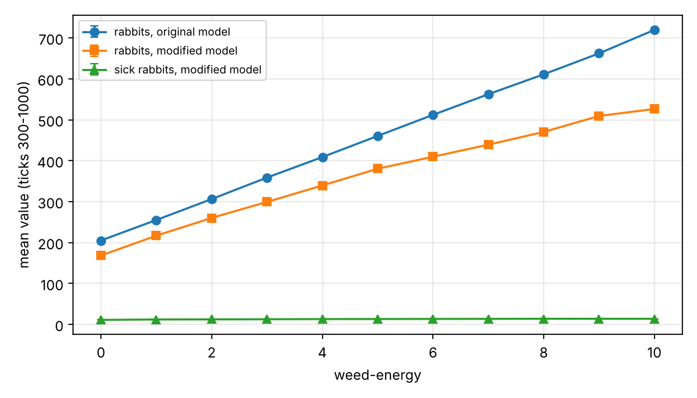

# Лабораторна робота 2

Тема: зміна логіки моделі NetLogo

Студент: Лімаренко Дмитро Ігорович, група СПм-25-2, варіант 6

Модель: Rabbits Grass Weeds (NetLogo), файл `Rabbits Grass Weeds_modified.nlogox`.

## 1. Завдання

Зміни за варіантом 6:

- додати можливість отруїтися при поїданні бур'яну (ймовірність задається параметром);
- хворий кролик не може харчуватися, переміщатися і розмножуватися, позначається іншим кольором і залишається хворим 3 такти;
- додати поділ кроликів на самців і самок;
- народження нового кролика вимагає ситості, здоров'я та присутності в одній із сусідніх клітин сита здорового кролика протилежної статі; потомство з'являється з ймовірністю 50%.

Власна зміна: смерть кролика від старості (змінна `age` і параметр `max-age`).

Зміни зроблено в чотири етапи: хвороба та отруєння, стать, нові умови розмноження, старість.

## 2. Зміни в коді

### Нові змінні та параметри

Кожен кролик отримав три нові змінні: `sex` (стать, `"male"` або `"female"`), `sick-ticks` (скільки тактів ще залишилось хворіти, 0 - здоровий) і `age` (вік у тактах). Тривалість хвороби задається глобальною константою `sick-duration` = 3. На вкладці Interface додано два слайдери: `poison-chance` (ймовірність отруїтися, %, від 0 до 100, за замовчуванням 20) і `max-age` (максимальний вік, від 100 до 1000, за замовчуванням 300), а також монітор `sick rabbits` і лінію `sick` на графіку Populations.

``` NetLogo
globals [ sick-duration ]
rabbits-own [ energy sex sick-ticks age ]

to setup
  clear-all
  set sick-duration 3
  ...
  create-rabbits number [
    setxy random-xcor random-ycor
    set energy random 10
    set sex one-of [ "male" "female" ]
    set sick-ticks 0
    set age 0
    update-color
  ]
  reset-ticks
end
```

### Зміна 1: отруєння бур'яном і хвороба

При поїданні бур'яну кролик, як і раніше, отримує енергію, але з ймовірністю `poison-chance` відсотків отруюється: `sick-ticks` стає рівним `sick-duration`.

``` NetLogo
to eat-weeds
  if pcolor = violet
  [ set pcolor black
    set energy energy + weed-energy
    if random-float 100 < poison-chance
      [ set sick-ticks sick-duration ] ]
end

to-report sick?
  report sick-ticks > 0
end
```

У головній процедурі `go` хворий кролик замість звичайних дій лише зменшує лічильник хвороби на 1: він не рухається, не їсть і не розмножується. Після трьох тактів лічильник стає нульовим, і кролик знову здоровий.

``` NetLogo
to go
  if not any? rabbits [ stop ]
  grow-grass-and-weeds
  ask rabbits
  [ ifelse sick?
    [ set sick-ticks sick-ticks - 1 ]
    [ move
      eat-grass
      eat-weeds
      reproduce ]
    set age age + 1
    update-color
    death ]
  tick
end
```

Колір кролика залежить від стану: хворий - червоний, здорова самка - рожева, здоровий самець - блакитний (процедура `update-color`).

``` NetLogo
to update-color
  ifelse sick?
  [ set color red ]
  [ ifelse sex = "female" [ set color pink ] [ set color cyan ] ]
end
```

### Зміна 2: стать і нові умови розмноження

Стать призначається випадково при створенні кролика й нащадка. Народжувати може лише самка, і лише якщо вона здорова та сита (`energy > birth-threshold`), а на її клітинці або на одній із сусідніх є здоровий ситий самець. Навіть тоді потомство з'являється з ймовірністю 50%. Енергія, як і раніше, ділиться навпіл між самкою та нащадком. Народжує саме самка, щоб кожну пару не враховувати двічі.

``` NetLogo
to reproduce
  if sex = "female" and not sick? and energy > birth-threshold and partner-nearby?
  [ if random-float 100 < 50
    [ set energy energy / 2
      hatch 1 [
        set sex one-of [ "male" "female" ]
        set sick-ticks 0
        set age 0
        update-color
        fd 1 ] ] ]
end

to-report partner-nearby?
  let my-sex sex
  report any? ((rabbits-on (patch-set patch-here neighbors))
    with [ sex != my-sex and not sick? and energy > birth-threshold ])
end
```

### Зміна 3 (власна): смерть від старості

У вихідній моделі кролик помирав лише від браку енергії, тож при достатку їжі міг жити необмежено довго. Тепер вік збільшується на 1 щотакту (див. `go`), а при перевищенні `max-age` кролик помирає.

``` NetLogo
to death
  if energy < 0 or age > max-age [ die ]
end
```

## 3. Експеримент на ефект змін

Мета: порівняти вихідну й змінену модель при однакових параметрах і побачити, як змінило поведінку отруєння бур'яном.

Початкові умови (однакові для обох моделей): number = **150**, birth-threshold = **15**, grass-grow-rate = **15**, grass-energy = **5**, weeds-grow-rate = **15** (бур'ян увімкнено). Для зміненої моделі додатково: poison-chance = **20**, max-age = **300**.

Змінюємо `weed-energy` від 0 до 10 з кроком 1; 5 повторів, 1000 тактів; середнє по тактах 300-1000. Результати вихідної моделі взято з експерименту 3 лабораторної роботи 1 (ті самі умови).

| weed-energy | Кролики (оригінал) | Кролики (змінена) | Хворі (змінена) |
|:-:|:-:|:-:|:-:|
| 0 | 205.0 (±1.9) | 168.3 (±2.9) | 11.0 (±0.1) |
| 1 | 255.0 (±1.8) | 216.7 (±4.1) | 11.9 (±0.2) |
| 2 | 306.2 (±1.8) | 260.1 (±3.2) | 12.2 (±0.2) |
| 3 | 358.7 (±2.2) | 299.1 (±5.2) | 12.5 (±0.3) |
| 4 | 408.7 (±3.1) | 339.4 (±5.7) | 13.0 (±0.1) |
| 5 | 460.4 (±3.5) | 380.2 (±5.4) | 13.1 (±0.3) |
| 6 | 511.9 (±3.3) | 409.6 (±7.7) | 13.3 (±0.2) |
| 7 | 562.4 (±4.5) | 439.1 (±2.7) | 13.4 (±0.2) |
| 8 | 610.9 (±4.3) | 470.2 (±3.7) | 13.7 (±0.2) |
| 9 | 662.1 (±1.6) | 509.2 (±6.0) | 13.7 (±0.2) |
| 10 | 719.5 (±1.1) | 526.3 (±5.3) | 13.7 (±0.1) |

У дужках - стандартне відхилення між 5 повторами. Вимирань кроликів у жодному з повторів не було.



Висновок: у зміненій моделі кроликів менше за вихідну при всіх значеннях `weed-energy`: від 168 проти 205 при 0 (на 18% менше) до 526 проти 720 при 10 (на 27% менше). Різниця зростає разом з калорійністю бур'яну. Імовірна причина - нові умови розмноження: народжує тільки самка, їй потрібен ситий здоровий самець поблизу, і потомство з'являється лише в половині випадків, а ще кролик гине від старості. Зростання чисельності з `weed-energy` залишилось майже лінійним, але повільнішим (близько 36 кроликів на одиницю енергії замість 51). Хворих одночасно завжди небагато, 11-14 особин (від 7% популяції при слабкому бур'яні до 3% при найкалорійнішому), вони майже не залежать від `weed-energy`.

### Додатковий експеримент: poison-chance

Змінюємо `poison-chance` від 0 до 100 з кроком 10 при weed-energy = **5**, решта параметрів ті самі.

Кількість вимирань - 0 для всіх значень. Середнє по тактах 300-1000, 5 повторів.

| poison-chance | Кролики | Хворі | Трава | Бур'ян |
|:-:|:-:|:-:|:-:|:-:|
| 0 | 365.4 (±4.2) | 0.0 (±0.0) | 97.0 (±1.0) | 95.0 (±2.0) |
| 10 | 370.4 (±5.7) | 6.6 (±0.2) | 97.5 (±1.1) | 95.4 (±1.4) |
| 20 | 375.1 (±5.9) | 13.2 (±0.1) | 98.1 (±1.5) | 96.2 (±1.5) |
| 30 | 380.6 (±6.1) | 19.8 (±0.2) | 97.4 (±1.9) | 97.1 (±1.5) |
| 40 | 386.7 (±3.0) | 26.1 (±0.3) | 98.5 (±1.3) | 97.2 (±1.8) |
| 50 | 391.7 (±4.2) | 32.5 (±0.2) | 99.0 (±1.7) | 96.9 (±1.4) |
| 60 | 400.4 (±2.8) | 39.2 (±0.2) | 98.8 (±1.8) | 97.3 (±1.0) |
| 70 | 407.3 (±8.5) | 45.7 (±0.3) | 97.6 (±2.4) | 95.7 (±2.6) |
| 80 | 411.5 (±3.4) | 52.6 (±0.5) | 99.4 (±1.4) | 98.8 (±1.1) |
| 90 | 420.4 (±5.1) | 59.1 (±0.3) | 98.0 (±1.2) | 97.6 (±2.0) |
| 100 | 426.1 (±6.4) | 65.4 (±0.8) | 98.4 (±2.2) | 97.4 (±1.0) |


Висновок: зі зростанням ймовірності отруєння хворих кроликів стає більше, від 0 до 65 одночасно (при 100% це близько 15% популяції), але загальна чисельність не падає, а навіть трохи зростає: від 365 до 426. Кількість трави й бур'яну майже не змінюється (близько 97). Можливе пояснення: за умовами варіанту хворий кролик не рухається, тож не витрачає енергію на рух і не може померти від голоду, поки хворіє. Це варто пам'ятати: отруєння тут працює скоріше як короткий відпочинок, а не як покарання.

## Висновки

Додані правила (стать, отруєння, хвороба на 3 такти, старість) зменшили чисельність кроликів порівняно з вихідною моделлю, головно через складніші умови розмноження. Отруєння бур'яном саме по собі популяцію не зменшує: хворих завжди кілька відсотків, а чисельність навіть трохи зростає, бо хворий кролик не витрачає енергію. Модель стабільна: у жодному з 110 прогонів кролики не вимерли.
