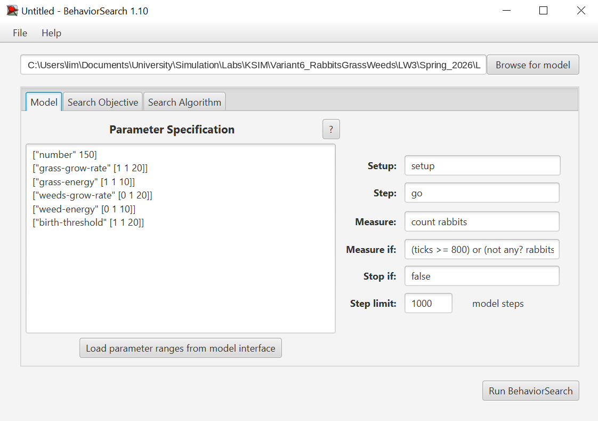
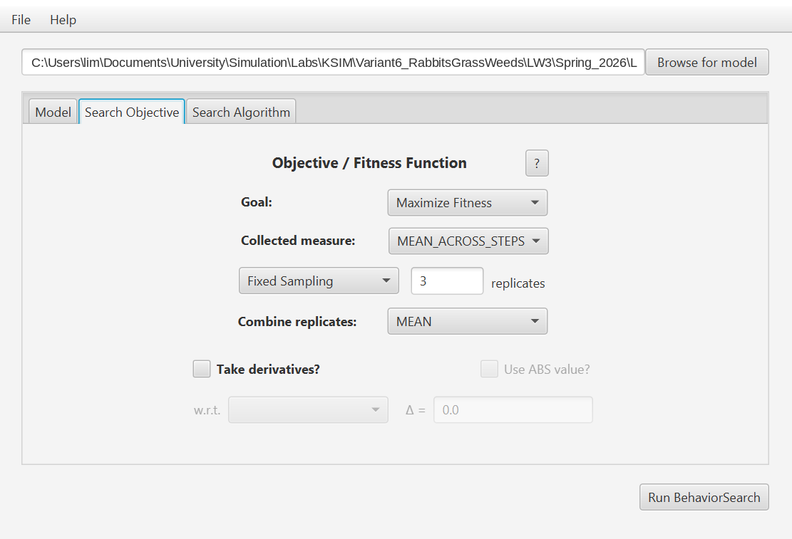
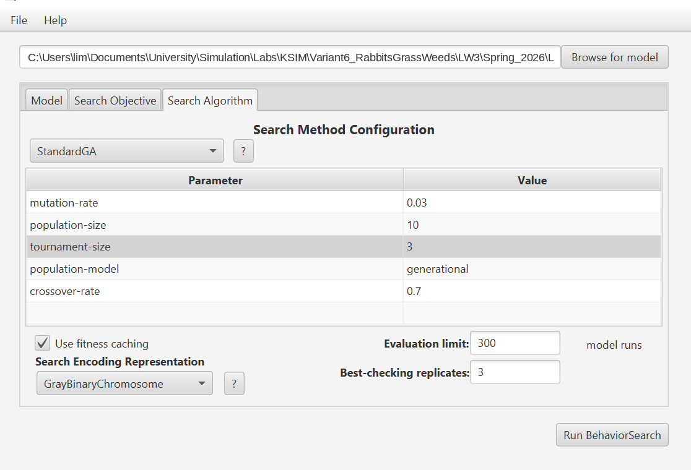
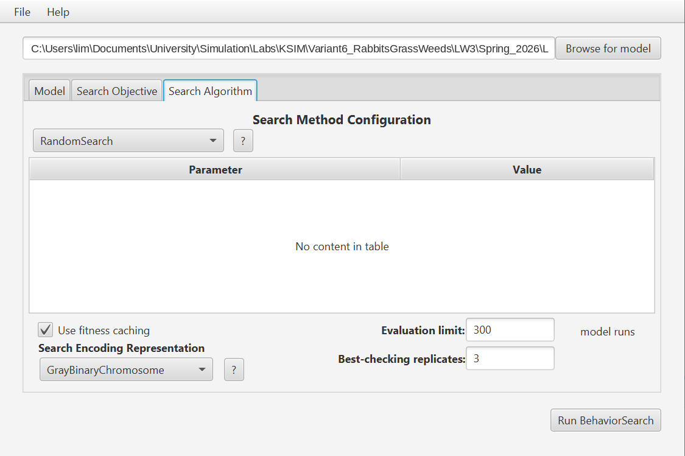
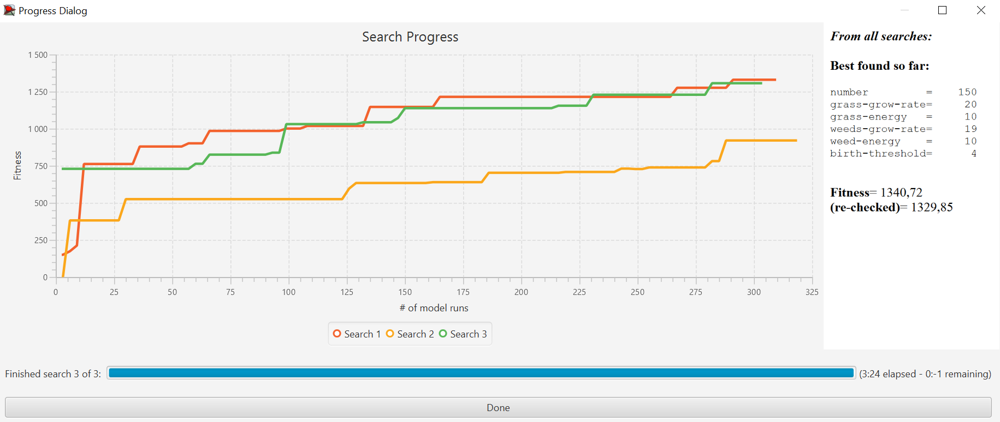
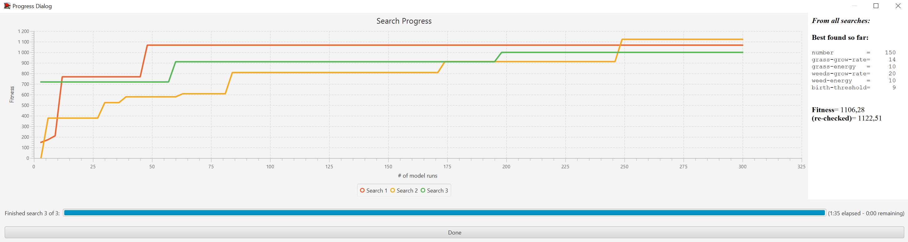
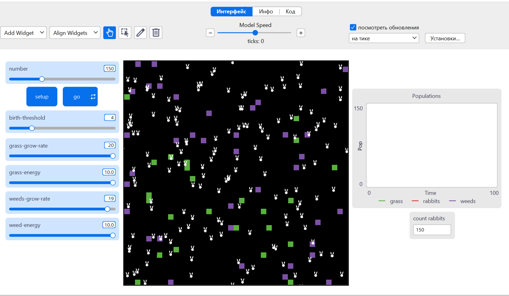
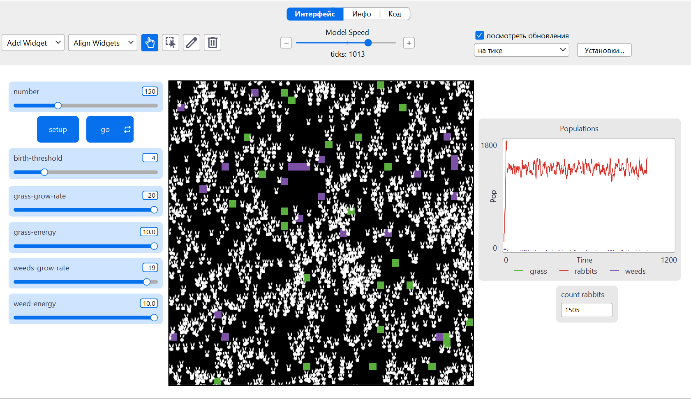

# Лабораторна робота 3

Тема: пошук параметрів моделі в BehaviorSearch

Студент: Лімаренко Дмитро Ігорович, група СПм-25-2, варіант 6

## 1. Мета пошуку

Модель: Rabbits Grass Weeds (базова версія, NetLogo 7.0.4, BehaviorSearch 1.10). У моделі кролики їдять траву і бур'яни, витрачають енергію на рух і розмножуються, коли енергія перевищує `birth-threshold`.

Мета - підібрати значення параметрів, при яких середня кількість кроликів на тактах 800-1000 максимальна. Цільова функція (максимізується):

```
count rabbits
```

Вимірюється на кожному такті, де виконується `(ticks >= 800) or (not any? rabbits)`, і усереднюється (MEAN_ACROSS_STEPS). Друга частина умови потрібна для випадку, коли всі кролики вимерли і модель зупинилась (тоді функція дорівнює 0).

## 2. Налаштування

Вкладка Model (параметри, показник, умови вимірювання):



Вкладка Search Objective (цільова функція):



Налаштування генетичного алгоритму:



Налаштування випадкового пошуку:



Керуючі параметри (простір пошуку):

| Параметр | Діапазон | Крок |
|---|---|---|
| grass-grow-rate | 1 - 20 | 1 |
| grass-energy | 1 - 10 | 1 |
| weeds-grow-rate | 0 - 20 | 1 |
| weed-energy | 0 - 10 | 1 |
| birth-threshold | 1 - 20 | 1 |

Сталий параметр: `number` (початкова кількість кроликів) = 150.

Метод 1: генетичний алгоритм (StandardGA): розмір популяції 10, mutation-rate 0.03, crossover-rate 0.7, tournament-size 3, generational, кодування GrayBinaryChromosome. Метод 2: випадковий пошук (RandomSearch).

| Налаштування | Значення |
|---|---|
| Evaluation limit | 300 запусків моделі |
| Повторів пошуку для кожного методу | 3 |
| Повторів моделі для однієї оцінки (fitness sampling) | 3 |
| Best-checking replicates | 3 |
| Кроків моделі (step limit) | 1000 |

## 3. Результати

Генетичний алгоритм:



Випадковий пошук:



Результати кожного з трьох повторів (fitness - середня кількість кроликів на тактах 800-1000; "після перевірки" - значення при повторній перевірці найкращого рішення на 3 нових прогонах моделі):

| Метод | Повтор | Знайдено | Після перевірки | grass-grow-rate | grass-energy | weeds-grow-rate | weed-energy | birth-threshold |
|---|:-:|:-:|:-:|:-:|:-:|:-:|:-:|:-:|
| Генетичний алгоритм | 1 | 1340.7 | 1329.8 | 20 | 10 | 19 | 10 | 4 |
| Генетичний алгоритм | 2 | 920.3 | 920.4 | 16 | 10 | 11 | 10 | 4 |
| Генетичний алгоритм | 3 | 1307.4 | 1306.5 | 19 | 9 | 20 | 10 | 2 |
| Випадковий пошук | 1 | 1064.3 | 1067.3 | 19 | 10 | 15 | 9 | 8 |
| Випадковий пошук | 2 | 1106.3 | 1122.5 | 14 | 10 | 20 | 10 | 9 |
| Випадковий пошук | 3 | 995.6 | 998.8 | 19 | 7 | 19 | 9 | 8 |

Підсумок за методами:

| Метод | Найкраще значення (після перевірки) | Середнє по повторах (після перевірки) | Знайдені параметри найкращого |
|---|:-:|:-:|---|
| Генетичний алгоритм | 1329.8 | 1185.6 | grass-grow-rate 20, grass-energy 10, weeds-grow-rate 19, weed-energy 10, birth-threshold 4 |
| Випадковий пошук | 1122.5 | 1062.9 | grass-grow-rate 14, grass-energy 10, weeds-grow-rate 20, weed-energy 10, birth-threshold 9 |

Якість усіх перевірених точок за хід пошуку (по 3 повторах, кожна точка - одна оцінка параметрів):

| Метод | Оцінок | Середнє значення цілі | Частка оцінок з результатом понад 1000 | Частка оцінок з результатом менше 100 |
|---|:-:|:-:|:-:|:-:|
| Генетичний алгоритм | 310 | 660.8 | 18.1% | 2.6% |
| Випадковий пошук | 300 | 328.3 | 0.7% | 18.0% |

## 4. Перевірка в NetLogo

Знайдені генетичним алгоритмом параметри (`grass-grow-rate` 20, `grass-energy` 10, `weeds-grow-rate` 19, `weed-energy` 10, `birth-threshold` 4, `number` 150) виставлено в моделі Rabbits Grass Weeds у NetLogo.

Початковий стан після setup:



Стан після 1013 тактів:



Кількість кроликів швидко зростає з 150 до піку близько 1800, потім стабілізується і коливається приблизно в межах 1300-1600 (на такті 1013 - 1505). Це відповідає значенню цільової функції, знайденому ГА (близько 1330 кроликів у середньому на тактах 800-1000). Бур'яни майже не накопичуються, бо кролики їх одразу з'їдають (weed-energy максимальна), трава і бур'ян ростуть швидко, тому їжі вистачає і поле повністю заповнене кроликами.

## 5. Порівняння

Генетичний алгоритм дав краще найкраще значення (1329.8 проти 1122.5 кроликів) і краще середнє по трьох повторах (1185.6 проти 1062.9). Значення після перевірки майже збігаються зі значеннями при пошуку в обох методів (різниця до 20 кроликів), тож знайдені результати стабільні, на відміну від моделі з вовками з варіанту 7.

Різниця видна і в тому, як методи ходять по простору параметрів: у ГА 18% усіх оцінених точок давали понад 1000 кроликів, а у випадкового пошуку тільки 0.7%, зате у випадкового пошуку 18% точок дали менше 100 кроликів (у ГА 2.6%). Тобто ГА швидко концентрується в хорошій області, а випадковий пошук витрачає значну частину оцінок на погані точки.

За швидкістю: у двох повторах з трьох ГА перейшов позначку 1000 приблизно на 100-му запуску (108 і 99), а у повторі 2 так і не дійшов (максимум 920). У випадкового пошуку позначку 1000 перейшов один повтор з трьох (на 48-му запуску повтору 1) і ще один знайшов 1106 лише на 249-му, повтор 3 не досяг 1000. Розкид між повторами у ГА більший (стандартне відхилення 230 проти 62 за перевіреними значеннями), оскільки повтор 2 застряг на гіршому значенні.

## Висновки

Генетичний алгоритм надійніше знаходить хороші параметри: краще найкраще значення (1329.8 проти 1122.5 кроликів) і краще середнє по повторах, а також більшу частку вдалих оцінок. Випадковий пошук дає стабільніший, але гірший результат. Найкращі параметри в обох методах близькі до меж діапазонів (maximum `grass-energy` і `weed-energy`, висока швидкість росту трави та бур'яну, мінімальний або невеликий `birth-threshold`), бо ціль "якомога більше кроликів" просто заохочує якомога більше їжі і швидке розмноження. Один з повторів ГА застряг на гіршому рішенні (920.3), тож для надійності краще робити кілька повторів.
