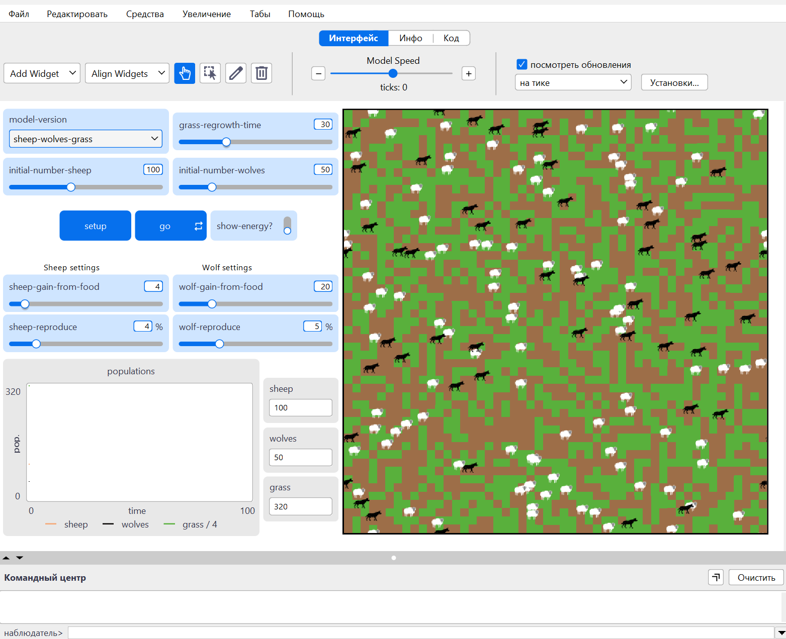
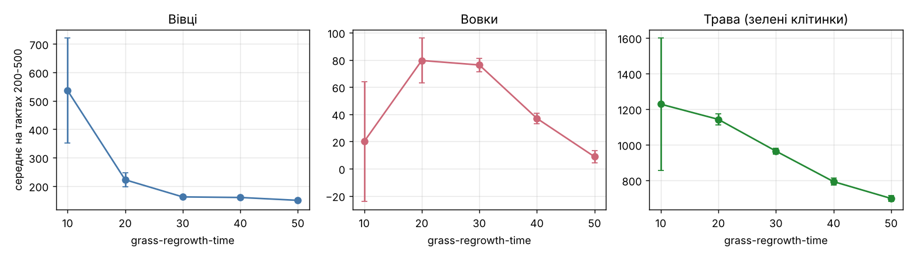
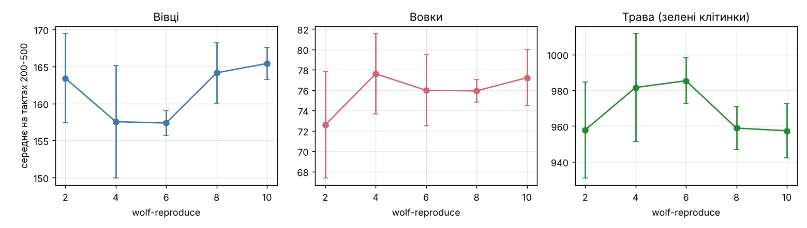
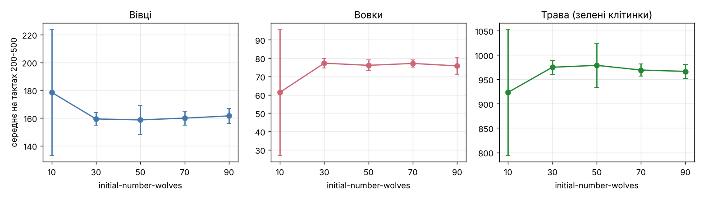

# Лабораторна робота 1

Тема: опис моделі та обчислювальні експерименти в NetLogo

Студент: Лімаренко Дмитро Ігорович, група СПм-25-2, варіант 7

## 1. Модель

Назва: Wolf Sheep Predation (бібліотека NetLogo, Models Library -> Biology).

Модель описує екосистему "трава - вівці - вовки". Вівці їдять траву, вовки їдять овець. Вівці та вовки рухаються випадково, витрачають на це енергію, поповнюють її їжею, а коли енергія опускається нижче нуля - гинуть. Також вони можуть розмножуватися з певною ймовірністю. Трава, з'їдена вівцею, відростає через заданий час. У результаті чисельність популяцій коливається: коли овець багато, вовкам вистачає їжі й їх стає більше, потім овець меншає, вовки голодують, і цикл повторюється.

## 2. Агенти і середовище

Середовище - поле 51x51 клітинок (координати від -25 до 25), замкнене в тор. Кожна клітинка (patch) має колір: зелений - трава є, коричневий - траву з'їдено. Змінна `countdown` показує, скільки тактів залишилось до відростання трави.

Агенти двох порід (breed):

- **вівці (sheep)** - змінна `energy`, білий колір, їдять траву;
- **вовки (wolves)** - змінна `energy`, чорний колір, їдять овець.

Початкова енергія в агентів випадкова: від 0 до подвоєного приросту від їжі.

## 3. Параметри

| Параметр | Значення за замовчуванням | Що означає |
|---|---|---|
| model-version | sheep-wolves-grass | версія моделі: вівці, вовки і трава |
| initial-number-sheep | 100 | початкова кількість овець |
| initial-number-wolves | 50 | початкова кількість вовків |
| grass-regrowth-time | 30 | за скільки тактів відростає з'їдена трава |
| sheep-gain-from-food | 4 | скільки енергії вівця отримує за з'їдену траву |
| wolf-gain-from-food | 20 | скільки енергії вовк отримує за з'їдену вівцю |
| sheep-reproduce | 4 (%) | ймовірність народження вівці на кожному такті |
| wolf-reproduce | 5 (%) | ймовірність народження вовка на кожному такті |
| show-energy? | вимкнено (false) | показувати енергію агентів на екрані (на результати не впливає) |

## 4. Алгоритм

Початок (`setup`): очищується світ; у версії з травою кожна клітинка випадково стає зеленою або коричневою (для коричневих `countdown` обирається випадково); створюються вівці та вовки у випадкових місцях з випадковою енергією.

Один такт (`go`):

1. Якщо не лишилось жодного агента - модель зупиняється. Якщо вовків немає, а овець більше за `max-sheep` (30000) - теж зупиняється.
2. Кожна вівця рухається (повертає трохи вліво-вправо й іде на 1 клітинку), втрачає 1 одиницю енергії, їсть траву, якщо стоїть на зеленій клітинці (клітинка стає коричневою, енергія зростає на `sheep-gain-from-food`), гине при енергії менше нуля, а потім з ймовірністю `sheep-reproduce` % народжує нащадка - енергія ділиться навпіл.
3. Кожен вовк рухається, втрачає 1 одиницю енергії, з'їдає одну випадкову вівцю на своїй клітинці (енергія зростає на `wolf-gain-from-food`), гине при енергії менше нуля і з ймовірністю `wolf-reproduce` % розмножується аналогічно вівцям.
4. Кожна коричнева клітинка зменшує `countdown` на 1, а коли він досягає 0 - знову стає зеленою.

## 5. Недоліки моделі

- Агенти рухаються суто випадково: вовки не бачать і не переслідують овець, вівці не тікають від вовків і не шукають траву.
- Немає віку: агент помирає тільки від голоду чи від вовка, тому немає природної смерті, а всі особини однакові (немає статі, швидкості, сили).
- Світ замкнений у тор і однорідний: немає перешкод, укриттів, пір року, тож трава відростає з однаковою швидкістю на всьому полі.

## 6. Експерименти

Налаштування: BehaviorSpace, 5 повторів на кожне значення, 500 тактів, метрики: `count sheep`, `count wolves`, `count grass`. Значення усереднювались по тактах 200-500 (після виходу на стабільний режим), якщо популяція вимерла, для тактів, що лишились, бралось 0. У дужках - стандартне відхилення між повторами. Решта параметрів - за замовчуванням.

Дані: `data/E1.csv`, `data/E2.csv`, `data/E3.csv`.

### Експеримент 1: grass-regrowth-time

Змінюємо: час відростання трави - 10, 20, 30, 40, 50 тактів. Ідея: чим довше росте трава, тим менше їжі в овець.

| grass-regrowth-time | Вівці | Вовки | Трава | Вимерли вовки (з 5) |
|:-:|:-:|:-:|:-:|:-:|
| 10 | 536.1 (±184.4) | 19.9 (±44.0) | 1227.8 (±371.2) | 4 |
| 20 | 222.2 (±24.0) | 79.5 (±16.5) | 1142.3 (±30.9) | 0 |
| 30 | 161.9 (±3.2) | 76.2 (±5.0) | 964.1 (±16.7) | 0 |
| 40 | 159.9 (±4.5) | 37.0 (±3.8) | 792.8 (±19.3) | 0 |
| 50 | 149.8 (±3.6) | 8.8 (±4.6) | 698.0 (±16.3) | 1 |

Висновок: чим швидше відростає трава, тим більше овець і трави. При значенні 10 вовки вимерли в 4 з 5 повторів, і вівці розмножились до 580-650 особин (в одному повторі, навпаки, вимерли вівці, тому середнє має великий розкид). Для значень 20-30 система стабільна: вовків близько 76-80, овець 160-220. При збільшенні до 40-50 овець майже не меншає, а от вовків стає значно менше (37 і 9), а в одному повторі при 50 вони зникли зовсім: корму для овець мало, отже мало і для вовків.

### Експеримент 2: wolf-reproduce

Змінюємо: ймовірність розмноження вовків - 2, 4, 6, 8, 10 %. Ідея: перевірити, як швидкість розмноження вовків впливає на овець.

| wolf-reproduce | Вівці | Вовки | Трава | Вимерли вовки (з 5) |
|:-:|:-:|:-:|:-:|:-:|
| 2 | 163.4 (±6.0) | 72.6 (±5.2) | 957.8 (±26.9) | 0 |
| 4 | 157.5 (±7.6) | 77.6 (±3.9) | 981.6 (±30.1) | 0 |
| 6 | 157.4 (±1.7) | 76.0 (±3.5) | 985.3 (±12.7) | 0 |
| 8 | 164.1 (±4.1) | 75.9 (±1.1) | 958.9 (±12.0) | 0 |
| 10 | 165.4 (±2.2) | 77.2 (±2.8) | 957.3 (±15.1) | 0 |

Висновок: у діапазоні 2-10 % середні значення майже не змінюються: овець приблизно 157-165, вовків 73-78, і вимирань немає. Різниця між значеннями не більша за розкид між повторами. Отже, чисельність вовків тут визначається насамперед кількістю овець (їжі), а не швидкістю їх розмноження.

### Експеримент 3: initial-number-wolves

Змінюємо: початкова кількість вовків - 10, 30, 50, 70, 90. Ідея: перевірити, чи залежить результат від стартового числа хижаків.

| initial-number-wolves | Вівці | Вовки | Трава | Вимерли вовки (з 5) |
|:-:|:-:|:-:|:-:|:-:|
| 10 | 178.4 (±45.3) | 61.3 (±34.3) | 923.3 (±129.3) | 1 |
| 30 | 159.3 (±4.5) | 77.2 (±2.6) | 974.9 (±14.1) | 0 |
| 50 | 158.6 (±10.6) | 76.1 (±3.0) | 978.8 (±45.2) | 0 |
| 70 | 159.9 (±5.1) | 77.1 (±1.9) | 969.1 (±12.5) | 0 |
| 90 | 161.5 (±5.5) | 75.8 (±4.7) | 966.4 (±14.7) | 0 |

Висновок: від 30 до 90 вовків на старті система виходить на майже однаковий стан (вівці близько 160, вовки близько 76), тобто початкові умови "забуваються". Виняток - 10 вовків: розкид між повторами великий, а в одному з п'яти повторів вовки вимерли, бо їх було замало, щоб вижити на початку.

## Висновки

Найсильніше на модель впливає швидкість відростання трави: від неї залежить, скільки овець і вовків зможуть вижити. Занадто швидка трава призводить до вибуху чисельності овець і вимирання вовків, занадто повільна - до різкого спаду вовків. Швидкість розмноження вовків і початкова кількість вовків (від 30 і більше) майже не змінюють підсумковий стан, система сама приходить до однакової рівноваги. Мала початкова популяція вовків (10) є ризикованою, бо там можливе вимирання.
