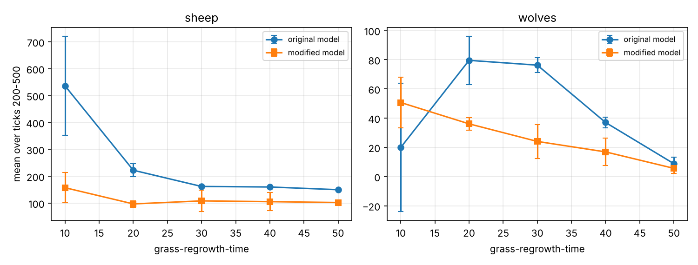
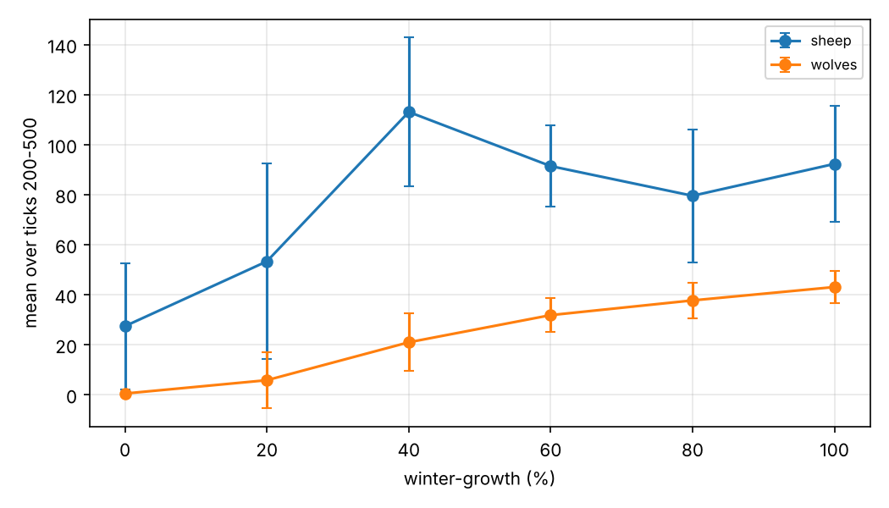

# Лабораторна робота 2

Тема: зміна логіки моделі NetLogo

Студент: Лімаренко Дмитро Ігорович, група СПм-25-2, варіант 7

Модель: Wolf Sheep Predation (NetLogo), файл `Wolf Sheep Predation_modified.nlogox`.

## 1. Завдання

Зміни за варіантом 7:

- прибрати "зграйність" вовків: перед початком ходу вовк "роззирається", перевіряє оточення і обирає напрямок руху, виходячи з наявності вівець та відсутності інших вовків; якщо іншої можливості немає - рухається випадково;
- якщо на одній ділянці поля опиняються два вовки, залишається лише один;
- вівці рухаються випадково, але якщо на одній із сусідніх клітинок виявлено вовка, змінюють напрямок на протилежний.

Власна зміна: сезонність - раз на `season-length` тактів літо змінюється зимою, і взимку трава відростає повільніше.

Зміни зроблено у три етапи: поведінка вовків, поведінка овець, сезони.

## 2. Зміни в коді

### Нові змінні та параметри

Додано глобальну змінну `wolves-merged` - лічильник вовків, видалених через те, що на одній клітинці зібралося кілька вовків. На вкладці Interface додано слайдери `season-length` (тривалість сезону в тактах, від 10 до 500, за замовчуванням 100) і `winter-growth` (з якою ймовірністю взимку зменшується таймер відростання трави, у %, за замовчуванням 50), а також монітори `season` і `wolves merged`.

``` NetLogo
globals [
  max-sheep
  wolves-merged   ; how many wolves were removed because two wolves shared one patch
]
```

### Зміна 1: вовки-одинаки

Замість випадкового руху вовк тепер спочатку озирається на восьми сусідніх клітинках (процедура `wolf-move`). Він надає перевагу клітинці, де є вівці й немає інших вовків. Якщо таких немає - обирає будь-яку клітинку без вовків. Лише коли вибору немає зовсім, вовк рухається випадково, як у вихідній моделі.

``` NetLogo
to wolf-move  ; wolf procedure
  let prey-patches neighbors with [ any? sheep-here and not any? wolves-here ]
  let free-patches neighbors with [ not any? wolves-here ]
  (ifelse
    any? prey-patches [
      let target one-of prey-patches
      face target
      move-to target
    ]
    any? free-patches [
      let target one-of free-patches
      face target
      move-to target
    ]
    [ move ])
end
```

Якщо все ж два вовки опинилися на одній клітинці (наприклад, новонароджений вовк), один з них видаляється. Процедура викликається в `setup` після створення вовків і в `go` після ходу всіх вовків:

``` NetLogo
to remove-extra-wolves
  ask patches with [ count wolves-here > 1 ] [
    let extra count wolves-here - 1
    ask n-of extra wolves-here [ die ]
    set wolves-merged wolves-merged + extra
  ]
end
```

### Зміна 2: вівці тікають від вовків

Вівця шукає вовка на сусідніх клітинках. Якщо знаходить - повертається до нього, розвертається на 180 градусів і робить крок; інакше рухається випадково, як раніше.

``` NetLogo
to sheep-move  ; sheep procedure
  let danger one-of wolves-on neighbors
  ifelse danger != nobody
  [ face danger
    rt 180
    fd 1 ]
  [ move ]
end
```

У процедурі `go` виклики `move` для овець і вовків замінено на `sheep-move` і `wolf-move`.

### Зміна 3 (власна): зима

Рік складається з літа та зими по `season-length` тактів. Зима визначається процедурою `winter?`, а в процедурі `grow-grass` таймер відростання трави взимку зменшується не щотакту, а лише з ймовірністю `winter-growth` відсотків.

``` NetLogo
to-report winter?
  report (ticks mod (2 * season-length)) >= season-length
end

to grow-grass  ; patch procedure
  if pcolor = brown [
    ifelse countdown <= 0
      [ set pcolor green
        set countdown grass-regrowth-time ]
      [ if (not winter?) or (random-float 100 < winter-growth)
          [ set countdown countdown - 1 ] ]
  ]
end
```

## 3. Експеримент на ефект змін

Мета: порівняти вихідну й змінену модель при однакових параметрах.

Початкові умови (однакові для обох моделей): model-version = **sheep-wolves-grass**, initial-number-sheep = **100**, initial-number-wolves = **50**, sheep-gain-from-food = **4**, wolf-gain-from-food = **20**, sheep-reproduce = **4**, wolf-reproduce = **5**. Для зміненої моделі додатково: season-length = **100**, winter-growth = **50**.

Змінюємо `grass-regrowth-time` - 10, 20, 30, 40, 50; 5 повторів, 500 тактів; середнє по тактах 200-500 (для вимерлої популяції на тактах, що лишилися, береться 0). У дужках - стандартне відхилення між повторами. Результати вихідної моделі взято з експерименту 1 лабораторної роботи 1 (ті самі умови).

| grass-regrowth-time | Вівці (оригінал) | Вівці (змінена) | Вовки (оригінал) | Вовки (змінена) | Вимерли вовки, оригінал / змінена (з 5) |
|:-:|:-:|:-:|:-:|:-:|:-:|
| 10 | 536.1 (±184.4) | 157.3 (±56.1) | 19.9 (±44.0) | 50.6 (±17.5) | 4/3 |
| 20 | 222.2 (±24.0) | 96.9 (±12.0) | 79.5 (±16.5) | 36.1 (±4.3) | 0/2 |
| 30 | 161.9 (±3.2) | 108.2 (±40.2) | 76.2 (±5.0) | 24.0 (±11.7) | 0/4 |
| 40 | 159.9 (±4.5) | 105.4 (±34.0) | 37.0 (±3.8) | 16.9 (±9.4) | 0/2 |
| 50 | 149.8 (±3.6) | 102.1 (±9.5) | 8.8 (±4.6) | 5.6 (±3.6) | 1/4 |



Висновок: у зміненій моделі і вівець, і вовків менше, ніж у вихідній, майже при всіх значеннях (наприклад, при 20: 97 проти 222 овець і 36 проти 80 вовків; при 30: 108 проти 162 овець і 24 проти 76 вовків). Вовки в зміненій моделі значно вразливіші: за 500 тактів вони вимерли у 15 з 25 прогонів проти 5 з 25 у вихідній, а при стандартному значенні 30 - у 4 з 5. Розкид між повторами теж помітно більший. Ймовірно, вовки-одинаки, які цілеспрямовано йдуть до овець, швидко знищують їх, після чого самі голодують, тож чисельність обох популяцій різко коливається. Цей ефект змішаний із зимою, тому нижче окремо оцінюємо, що дає лише зміна поведінки.

### Додатковий експеримент: winter-growth

Змінюємо `winter-growth` - 0, 20, 40, 60, 80, 100 % при grass-regrowth-time = **30**, season-length = **100**, решта параметрів ті самі; 5 повторів, 500 тактів, середнє по тактах 200-500. Значення 100 означає, що взимку трава росте так само, як улітку, тобто сезонність вимкнена, і в цьому випадку видно ефект лише зміненої поведінки вовків і овець. Для порівняння: у вихідній моделі при тих самих умовах було 161.9 вівці та 76.2 вовка. Середнє значення трави в рядках з вимиранням рахується лише по прогонах, що вижили.

| winter-growth | Вівці | Вовки | Трава | Видалено вовків (за прогін) | Вимерли вовки (з 5) | Вимерли вівці (з 5) |
|:-:|:-:|:-:|:-:|:-:|:-:|:-:|
| 0 | 27.4 (±25.2) | 0.4 (±0.2) | 1059.0 (±416.2) | 5.8 (±1.9) | 5 | 3 |
| 20 | 53.3 (±39.1) | 5.8 (±11.2) | 1499.6 (±283.8) | 6.4 (±3.6) | 5 | 1 |
| 40 | 113.0 (±29.7) | 20.9 (±11.5) | 1235.3 (±168.8) | 10.4 (±3.0) | 2 | 0 |
| 60 | 91.4 (±16.3) | 31.8 (±6.8) | 1403.3 (±75.7) | 12.2 (±2.6) | 0 | 0 |
| 80 | 79.5 (±26.5) | 37.7 (±7.1) | 1608.9 (±137.4) | 18.2 (±5.0) | 1 | 0 |
| 100 | 92.3 (±23.2) | 43.0 (±6.3) | 1588.6 (±73.2) | 18.8 (±6.5) | 0 | 0 |



Висновок: чим слабше взимку відростає трава, тим гірше живеться вовкам: при 0% вовки вимерли в усіх 5 повторах (в середньому лишилось 0.4 вовка), при 20% - теж у 5 з 5, а від 60% і вище - майже без вимирань (30-43 вовки). Вівці в усіх прогонах без зими (100%) коливаються навколо 92, у два рази менше, ніж у вихідній моделі (162), а вовків 43 проти 76 - тобто навіть без сезонності нова поведінка зменшила обидві популяції приблизно на 43-44%. Кількість вовків, видалених через спільну клітинку, зростає разом з чисельністю вовків: від 6 до 19 за прогін.

## Висновки

Нова поведінка вовків (вони йдуть до овець, але уникають одне одного) і овець (тікають від вовків) зробила модель менш стабільною: обидві популяції стали приблизно вдвічі меншими, а вовки часто вимирають. Сезонність посилила цей ефект: чим коротше й суворіше зима, тим менше шансів у вовків. Для спокійної рівноваги, як у вихідній моделі, потрібна м'якша зима (від 60% швидкості відростання) або інші значення параметрів.
