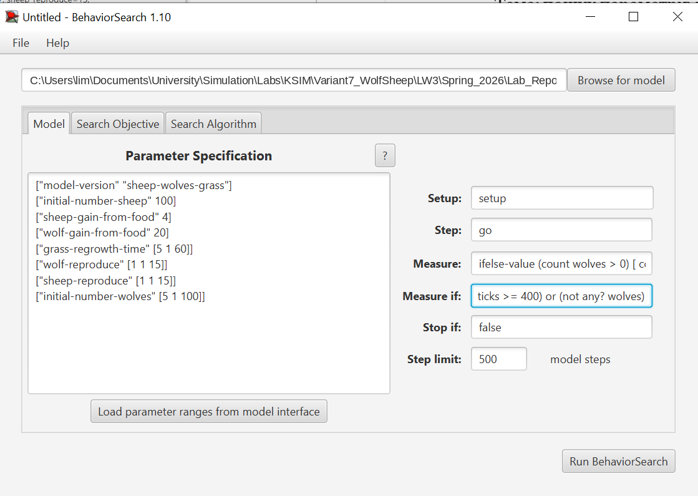
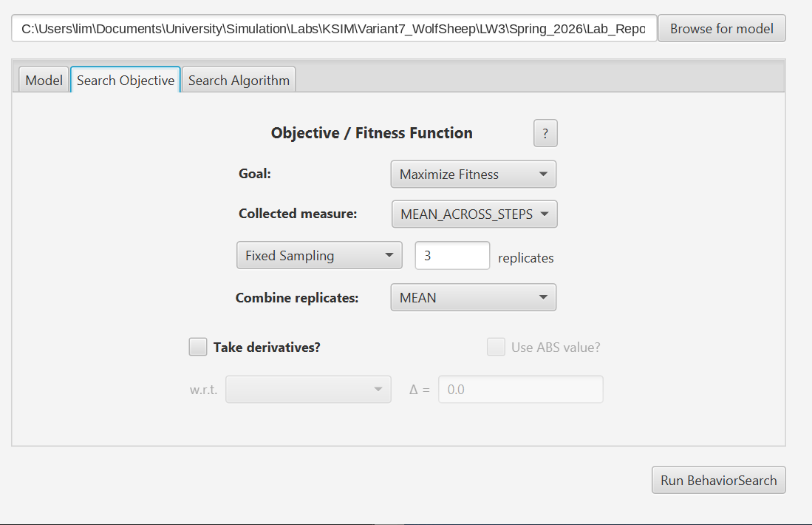
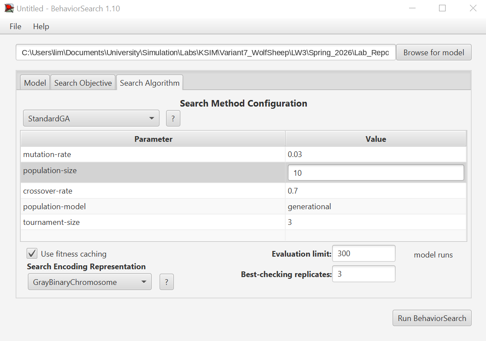
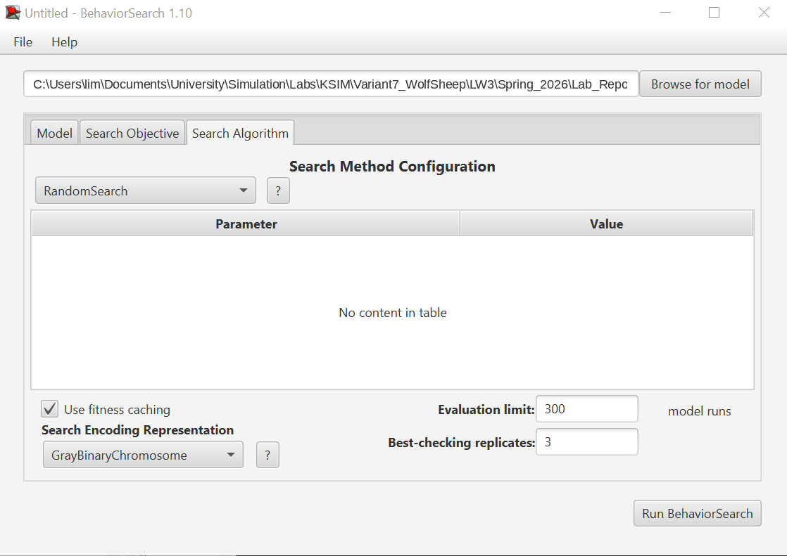
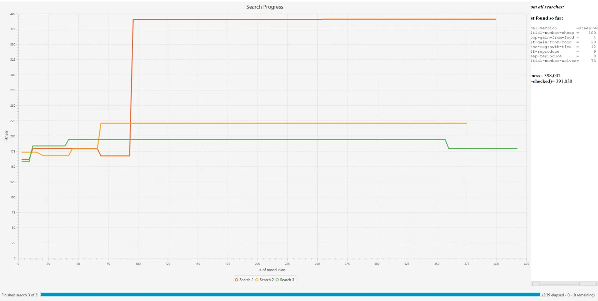
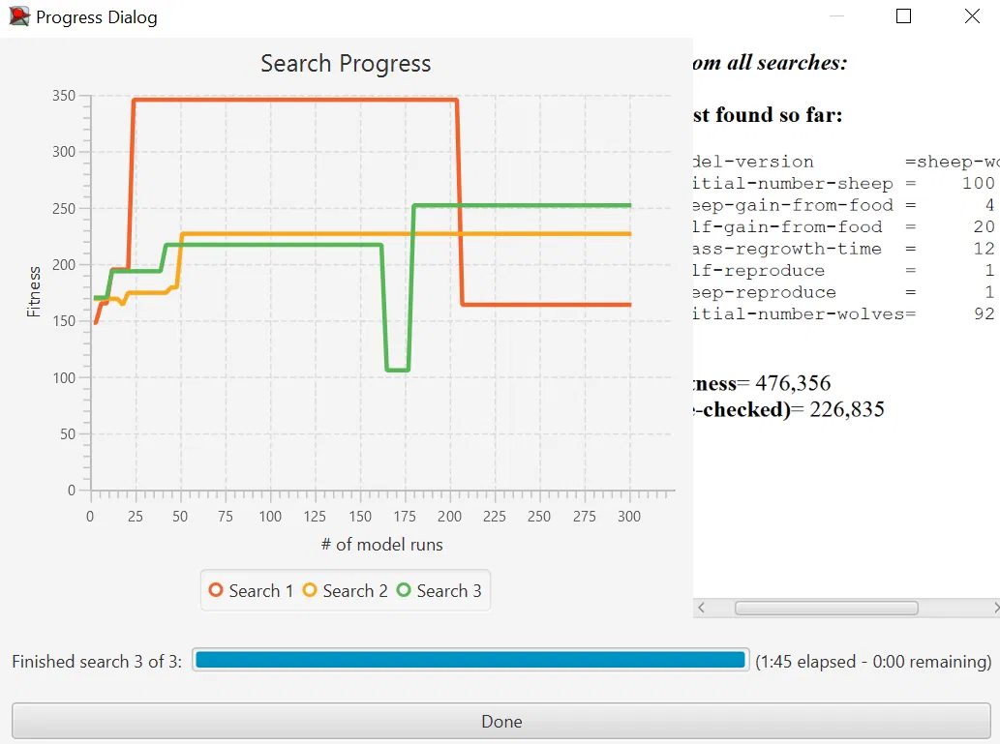
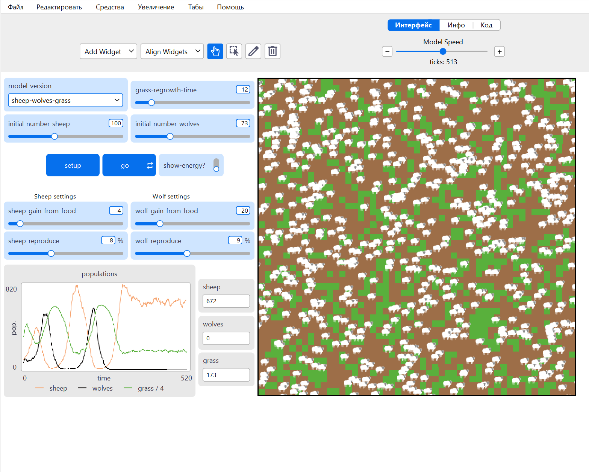
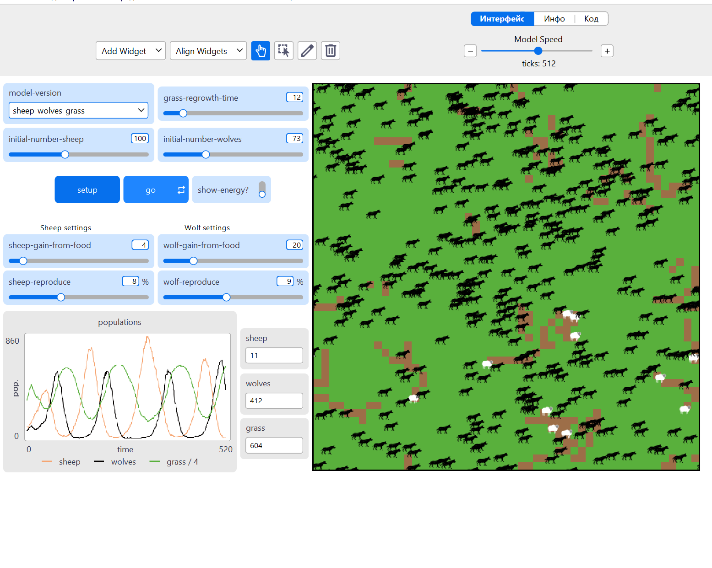

# Лабораторна робота 3

Тема: пошук параметрів моделі в BehaviorSearch

Студент: Лімаренко Дмитро Ігорович, група СПм-25-2, варіант 7

## 1. Мета пошуку

Модель: Wolf Sheep Predation (базова версія, режим `sheep-wolves-grass`, NetLogo 7.0.4, BehaviorSearch 1.10).

Мета - підібрати значення параметрів, при яких середня кількість овець на тактах 400-500 максимальна, а вовки при цьому не вимирають. Цільова функція (максимізується):

```
ifelse-value (count wolves > 0) [ count sheep ] [ 0 ]
```

Вона вимірюється на кожному такті, де виконується `(ticks >= 400) or (not any? wolves)`, і усереднюється (MEAN_ACROSS_STEPS). Якщо вовки вимерли, функція дорівнює 0, тому пошук штрафується за вимирання хижаків. Друга частина умови потрібна, щоб при вимиранні модель, що зупинилась, не давала порожнього вимірювання. Для обох методів функція однакова.

## 2. Налаштування

Вкладка Model (параметри, показник, умови вимірювання):



Вкладка Search Objective (цільова функція):



Налаштування генетичного алгоритму:



Налаштування випадкового пошуку:



Керуючі параметри (простір пошуку):

| Параметр | Діапазон | Крок |
|---|---|---|
| grass-regrowth-time | 5 - 60 | 1 |
| wolf-reproduce | 1 - 15 | 1 |
| sheep-reproduce | 1 - 15 | 1 |
| initial-number-wolves | 5 - 100 | 1 |

Сталі параметри: `model-version` = "sheep-wolves-grass", `initial-number-sheep` = 100, `sheep-gain-from-food` = 4, `wolf-gain-from-food` = 20.

Метод 1: генетичний алгоритм (StandardGA): розмір популяції 10, mutation-rate 0.03, crossover-rate 0.7, tournament-size 3, generational, кодування GrayBinaryChromosome. Метод 2: випадковий пошук (RandomSearch).

| Налаштування | Значення |
|---|---|
| Evaluation limit | 300 запусків моделі |
| Повторів пошуку для кожного методу | 3 |
| Повторів моделі для однієї оцінки (fitness sampling) | 3 |
| Best-checking replicates | 3 |
| Кроків моделі (step limit) | 500 |
| Stop if | false |

## 3. Результати

Генетичний алгоритм:



Випадковий пошук:



Результати кожного з трьох повторів (fitness - середня кількість овець; "після перевірки" - значення при повторній перевірці найкращого рішення на 3 нових прогонах моделі):

| Метод | Повтор | Знайдено | Після перевірки | grass-regrowth-time | wolf-reproduce | sheep-reproduce | initial-number-wolves |
|---|:-:|:-:|:-:|:-:|:-:|:-:|:-:|
| Генетичний алгоритм | 1 | 398.0 | 391.0 | 12 | 9 | 8 | 73 |
| Генетичний алгоритм | 2 | 257.3 | 220.7 | 12 | 1 | 1 | 92 |
| Генетичний алгоритм | 3 | 247.6 | 179.1 | 20 | 14 | 5 | 60 |
| Випадковий пошук | 1 | 352.8 | 163.9 | 12 | 2 | 8 | 17 |
| Випадковий пошук | 2 | 476.4 | 226.8 | 12 | 1 | 1 | 92 |
| Випадковий пошук | 3 | 327.0 | 252.0 | 16 | 1 | 1 | 11 |

Підсумок за методами:

| Метод | Найкраще значення (після перевірки) | Середнє по повторах (знайдено) | Середнє по повторах (після перевірки) | Знайдені параметри найкращого |
|---|:-:|:-:|:-:|---|
| Генетичний алгоритм | 391.0 | 301.0 | 263.6 | grass-regrowth-time 12, wolf-reproduce 9, sheep-reproduce 8, initial-number-wolves 73 |
| Випадковий пошук | 345.6 | 385.4 | 214.2 | grass-regrowth-time 9, wolf-reproduce 8, sheep-reproduce 10, initial-number-wolves 94 |

Примітка: у випадкового пошуку в повторі 1 найкращим після перевірки виявилось інше рішення (345.6 при параметрах 9, 8, 10, 94), ніж найкраще за першою оцінкою (352.8, параметри 12, 2, 8, 17), тому в підсумковій таблиці наведено його.

## 4. Перевірка в NetLogo

Знайдені генетичним алгоритмом параметри (`grass-regrowth-time` 12, `wolf-reproduce` 9, `sheep-reproduce` 8, `initial-number-wolves` 73, решта за замовчуванням) перевірено в NetLogo: 5 прогонів по 500 тактів.

Типовий прогін - вовки вимерли (приблизно на 250-300 такті), після чого вівці розмножились до 650-740 і тримаються на рівні, який обмежує трава:



Прогін, де вовки вижили до кінця (412 вовків, але лише 11 овець - вівці майже зникли):



Підсумок 5 прогонів на такті 500-515 (вівці / вовки): 672 / 0, 11 / 412, 737 / 0, 648 / 0, 665 / 0. Вовки вижили лише в одному прогоні з п'яти, і в ньому овець майже не лишилось. Тобто при цих параметрах значення цільової функції в більшості прогонів було б 0 (вовки вимерли), і знайдене значення близько 391 - це результат вдалих запусків, а не типова поведінка моделі.

## 5. Порівняння

Найкраще значення після перевірки дав генетичний алгоритм: 391.0 проти 345.6 у випадкового пошуку. Середнє по трьох повторах після перевірки теж вище у ГА (263.6 проти 214.2), якщо брати результати по найкращих знайдених за першою оцінкою рішеннях.

За значеннями "знайдено" картина інша: випадковий пошук дав більше (385.4 проти 301.0), але при перевірці його значення впали майже вдвічі (наприклад, 476.4 до 226.8), а у ГА зменшились менше (301.0 до 263.6). Якщо ж брати для кожного повтору найкраще рішення вже після перевірки, середні майже збігаються (268.6 у ГА і 274.8 у випадкового пошуку), тож за цим показником методи рівноцінні. Тобто випадковий пошук частіше знаходив "щасливе" значення, яке при повторному запуску не підтверджувалось.

За швидкістю: найкраще рішення ГА з'являлось на 96-му (повтор 1), 69-му (повтор 2) і 42-му (повтор 3) запусках, у випадкового пошуку - на 24-му, 51-му і 180-му (мова про найкраще рішення після перевірки). Явної різниці по швидкості сходження немає, у обох методів значення різко стрибало один-два рази, а далі майже не росло. Перевірка в NetLogo це підтвердила: при знайдених ГА параметрах вовки вижили лише в одному з 5 прогонів, тож знайдене значення сильно залежить від випадковості. Результат сильно залежить від повтору: розкид між повторами великий (стандартне відхилення 107 у ГА і 63 у випадкового пошуку за перевіреними значеннями), тому трьох повторів замало для впевнених висновків.

## Висновки

Генетичний алгоритм дав трохи краще й стабільніше найкраще значення (391.0 проти 345.6 овець), але випадковий пошук поводиться схоже: різниця між методами менша, ніж розкид між повторами. Значення, знайдені без повторної перевірки, завищені, особливо у випадкового пошуку, а перевірка в NetLogo показала, що навіть найкращі параметри нестабільні: вовки вимирають у 4 прогонах з 5. Тому трьох повторів на оцінку замало, і перевірку краще проводити завжди. Серед найкращих рішень часто повторюється `grass-regrowth-time` близько 12 і висока початкова кількість вовків (73-94), а також низькі значення відтворення, при яких обидві популяції тримаються в рівновазі.
